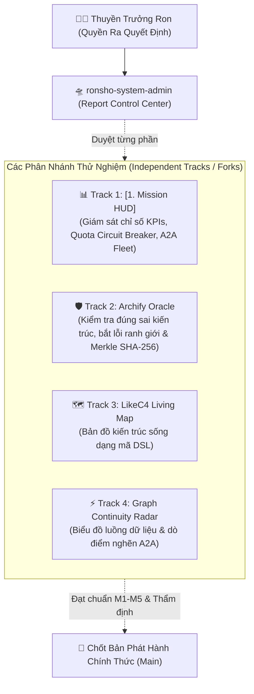

# 🛸 RON-SHO AIOS — Report Control & Management Center
### Trung Tâm Giám Sát, Báo Cáo & Ra Quyết Định Chiến Lược

[](https://github.com/phattrongtran15-pixel/ronsho-system-admin/actions/workflows/ci.yml)
[](https://opensource.org/licenses/MIT)
[]()
[]()

> **Tuyên ngôn sứ mệnh:** Repository này đóng vai trò là **Report Control & Management Center** của hệ điều hành tác tử **RON-SHO AIOS**, do Thuyền trưởng Ron (`phattrongtran15-pixel`) chỉ huy tối cao. Nơi đây hợp nhất các luồng báo cáo thời gian thực, kiểm toán tính đúng sai của kiến trúc và cung cấp bằng chứng vật lý (`Evidence Before Claims`) để hỗ trợ Thuyền trưởng ra quyết định nhanh chóng, chính xác và mạnh mẽ.

---

## 🎯 Định Hướng Kiến Trúc & Chiến Lược Phân Nhánh (Multi-Track Forks)

Hệ thống đang trong giai đoạn R&D tuyển chọn các khối công nghệ tối ưu. **Tuyệt đối không gộp vội vào một cụm duy nhất (chưa chốt main cứng)**, mà tổ chức lưu trữ và thử nghiệm theo từng phân nhánh/fork độc lập để Thuyền trưởng duyệt từng tính năng:



---

## 🧩 Các Khối Phân Hệ Trong Trung Tâm Điều Phối

### 1. 📊 [1. Mission HUD] — Báo Cáo & Chỉ Số Vận Hành
- **A2A Fleet Telemetry:** Giám sát trạng thái 4 tác tử cốt lõi (`RON RUNTIME`, `GOOSE WORKER`, `KILO LOCAL`, `ANTI CLOUD`).
- **Quota Circuit Breaker:** Cầu dao chống cháy quota, hiển thị ngân sách token tiêu thụ, chặn triệt để vòng lặp tự sửa lỗi vô hạn (Anti-Greedy Fallback).
- **Executive KPI Cards:** Báo cáo năng suất, số lượng vé bàn giao và tỷ lệ thành công của các phiên thực chiến.

### 2. 🛡️ Archify Oracle — Kiểm Tra Đúng Sai & Bằng Chứng Vật Lý
- **Gatekeeper Kiến Trúc:** Tự động phát hiện các thành phần vi phạm ranh giới bảo vệ (boundary encloses non-member) hoặc luồng kết nối sai hướng.
- **Merkle Proof Receipt:** Cấp chứng chỉ nghiệm thu SHA-256 cho cấu trúc hệ thống trước khi triển khai.
- **Standalone Explorer:** Bản vẽ trực quan độc lập, hỗ trợ dò vết hành trình dữ liệu (`Route Trace`), tầm ảnh hưởng Upstream/Downstream.

### 3. 🗺️ C4 Living Map — Bản Đồ Sống Hệ Thống *(Kế hoạch tích hợp)*
- Kiến trúc hóa bằng mã nguồn DSL (Architecture-as-Code).
- Tự động đồng bộ với thay đổi thực tế của các repository con.

### 4. ⚡ Graph Continuity — Radar Liền Mạch & Dò Điểm Nghẽn *(Kế hoạch tích hợp)*
- Theo dõi thông lượng dữ liệu giữa các Node tác tử A2A.
- Cảnh báo trực quan điểm trễ (latency bottleneck) và luồng tắc nghẽn.

---

## 💻 Sử Dụng & Vận Hành Cục Bộ (Local Guide)

### 1. Trải nghiệm nhanh bảng điều khiển (Zero Dependencies)
Mở trực tiếp file `index.html` bằng bất kỳ trình duyệt nào (Chrome, Edge, Firefox). Không cần cài đặt server.

### 2. Chạy với môi trường phát triển Node.js
```bash
# Cài đặt gói phụ trợ
pnpm install # hoặc npm install

# Khởi chạy máy chủ phát triển
pnpm dev

# Chạy kiểm thử tự động toàn diện
npm test

# Đóng gói sản phẩm
pnpm build
```

---

## 📜 Kỷ Luật Tối Thượng (Ron-Sho Operating Principles)

1. **Human Sovereignty:** Quyền ra quyết định tối cao luôn thuộc về Thuyền trưởng Ron. AI là công cụ hỗ trợ đề xuất, không thay thế con người.
2. **Zero Middleware:** Không biến Thuyền trưởng thành người đi copy-paste mã nguồn giữa các hệ thống.
3. **Evidence Before Claims:**
   - `UNKNOWN != PASS`
   - `FILE EXISTS != WORKS`
   - `EXECUTED != VERIFIED != ACCEPTED`

---

## 📄 Bản Quyền & Sở Hữu
Bản quyền kiến trúc thuộc về **Thuyền trưởng Ron (`phattrongtran15-pixel`)**. Phát hành theo giấy phép [MIT License](LICENSE).
